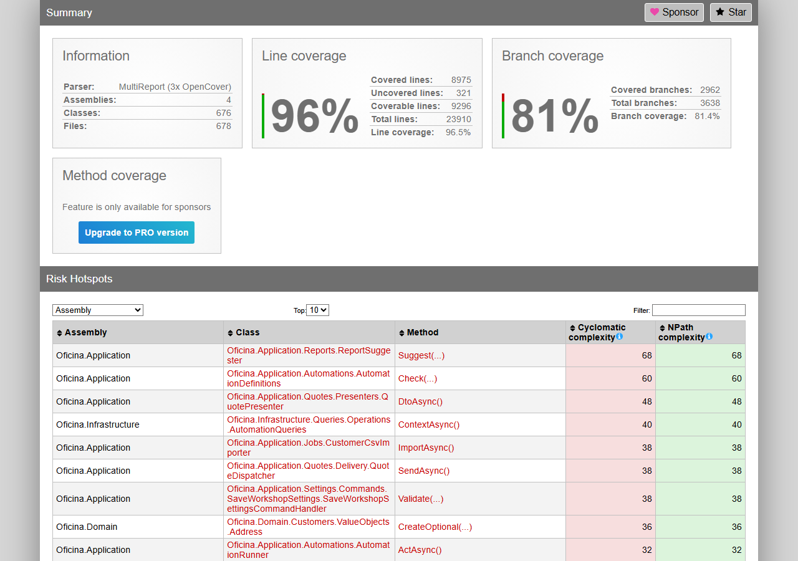

# Cobertura dos testes

Gerado em 2026-10-25T02:25:35Z por `node scripts/docs/coverage-report.mjs`, a partir do ReportGenerator (`coveragereport/Summary.json`) e do relatório do Vitest (`web/coverage/oficina-web/lcov.info`).

O enunciado pede 80% nos domínios críticos. O CI exige 85% de linhas sobre todo o `src/` do back-end (só `Migrations/` e `Program.cs` ficam fora) e 85% de linhas no front-end.

## Back-end (testes unitários, de contrato e funcionais somados)

| Indicador | Valor | Mínimo | Situação |
|---|---|---|---|
| Linhas | 96,5% (8975 de 9296) | 85% | ✅ |
| Branches | 81,4% (2962 de 3638) | — | — |
| Métodos | 98,1% | — | — |

### Por projeto

| Projeto | Linhas | Branches | Linhas cobertas |
|---|---|---|---|
| `Oficina.Api` | 99,7% | 75,2% | 664 de 666 |
| `Oficina.Application` | 95,3% | 79,8% | 4104 de 4308 |
| `Oficina.Domain` | 98,2% | 90,0% | 2077 de 2114 |
| `Oficina.Infrastructure` | 96,5% | 74,8% | 2130 de 2208 |

### Domínios críticos

| Namespace | Classes | Linhas | Mínimo | Situação |
|---|---|---|---|---|
| `Oficina.Domain.ServiceOrders` | 14 | 97,9% (418 de 427) | 80% | ✅ |
| `Oficina.Domain.Quotes` | 9 | 95,0% (191 de 201) | 80% | ✅ |
| `Oficina.Domain.Customers` | 10 | 99,6% (276 de 277) | 80% | ✅ |
| `Oficina.Domain.Inventory` | 7 | 97,5% (318 de 326) | 80% | ✅ |
| `Oficina.Domain.Catalog` | 7 | 99,5% (217 de 218) | 80% | ✅ |
| `Oficina.Application.ServiceOrders` | 50 | 93,8% (410 de 437) | 80% | ✅ |
| `Oficina.Application.Quotes` | 43 | 93,3% (430 de 461) | 80% | ✅ |
| `Oficina.Application.Customers` | 24 | 100,0% (206 de 206) | 80% | ✅ |
| `Oficina.Application.Inventory` | 43 | 93,5% (301 de 322) | 80% | ✅ |
| `Oficina.Application.Catalog` | 60 | 100,0% (518 de 518) | 80% | ✅ |

## Front-end (Vitest)

| Indicador | Valor | Mínimo | Situação |
|---|---|---|---|
| Linhas | 96,4% (7803 de 8097) | 85% | ✅ |
| Branches | 86,7% | — | — |
| Funções | 95,9% | — | — |

## Captura do relatório

## Como gerar de novo

1. Rode os testes do back-end com cobertura e o ReportGenerator (comandos no README, seção 9), incluindo `-reporttypes:Html;TextSummary;JsonSummary`.
2. Rode `npm test` dentro de `web/`.
3. Rode `node scripts/docs/coverage-report.mjs` na raiz.

O relatório HTML completo fica em `coveragereport/index.html` (não versionado; o CI publica como artefato).
