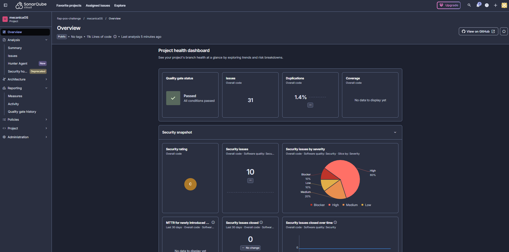

# Análise de vulnerabilidades — mecanicaOS

A análise roda no CI a cada push e pull request (`develop`, `develop-new` e `main`), em [.github/workflows/ci.yml](../../.github/workflows/ci.yml). Ela tem três frentes.

| Ferramenta | O que verifica | Onde roda | Quando falha |
|---|---|---|---|
| **SonarQube Cloud** | Análise estática do código C#: vulnerabilidades, security hotspots, bugs, code smells, duplicação e cobertura de testes | Job `build-and-test`, nas etapas `SonarQube begin` e `SonarQube end (Quality Gate)` | Quality Gate reprovado (`sonar.qualitygate.wait=true`) |
| **`dotnet list package --vulnerable --include-transitive`** | Pacotes NuGet diretos e transitivos com vulnerabilidade conhecida (GitHub Advisory Database) | Job `vulnerability-scan` | Qualquer pacote vulnerável |
| **Dependabot** | Atualizações de NuGet, das imagens Docker e das GitHub Actions | [.github/dependabot.yml](../../.github/dependabot.yml), toda semana | Abre um PR com a correção |

## Onde ver o resultado

- **SonarQube Cloud:** painel do projeto `fiap-pos-challenge_mecanicaOS` em https://sonarcloud.io/project/overview?id=fiap-pos-challenge_mecanicaOS (aba **Security** e **Security Hotspots**).
- **Pacotes NuGet:** no resumo de cada execução do job `vulnerability-scan` (aba **Actions** do GitHub) e no artefato `vulnerability-report` (`vulnerable-packages.txt` e `.json`).

## Resultado na versão entregue

Execução local em 02/11/2026, commit `2837e8f`, .NET SDK 10.0.400:

```text
$ dotnet list Oficina.slnx package --vulnerable --include-transitive

O projeto fornecido `Oficina.Api` não tem nenhum pacote vulnerável, considerando as fontes atuais.
O projeto fornecido `Oficina.Application` não tem nenhum pacote vulnerável, considerando as fontes atuais.
O projeto fornecido `Oficina.Domain` não tem nenhum pacote vulnerável, considerando as fontes atuais.
O projeto fornecido `Oficina.Infrastructure` não tem nenhum pacote vulnerável, considerando as fontes atuais.
O projeto fornecido `Oficina.ContractTests` não tem nenhum pacote vulnerável, considerando as fontes atuais.
O projeto fornecido `Oficina.FunctionalTests` não tem nenhum pacote vulnerável, considerando as fontes atuais.
O projeto fornecido `Oficina.UnitTests` não tem nenhum pacote vulnerável, considerando as fontes atuais.
```

**Nenhum pacote vulnerável** (diretos e transitivos).

SonarQube Cloud (Quality Gate **Passed**; painel em https://sonarcloud.io/project/overview?id=fiap-pos-challenge_mecanicaOS):



## Controles de segurança da aplicação

- Segredos fora do repositório: senha do SQL Server e chave do JWT vêm do arquivo `.env`, que não é versionado (modelo em [.env.example](../../.env.example)). Fora de Development, a chave do JWT vem da variável `Jwt__Secret` e é validada na subida (mínimo de 32 caracteres).
- Senhas com hash BCrypt; login limitado a 5 tentativas por minuto por IP (429).
- JWT com perfis (Admin, Attendant e Mechanic) e políticas por rota; rotas públicas só com número da OS e CPF/CNPJ, ou com token de aprovação de uso único.
- CPF/CNPJ e e-mail nunca na URL (buscas pelo corpo da requisição).
- Erros no formato ProblemDetails sem stack trace; Swagger só em Development.
- Imagem Docker roda com usuário sem privilégios (`USER $APP_UID`).
