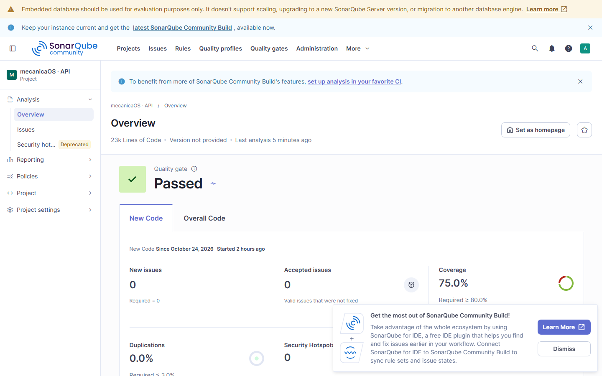
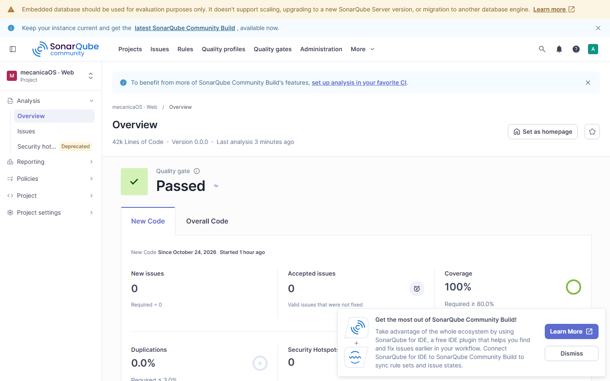

# Relatório do SonarQube

Gerado por `node scripts/sonar/run-analysis.mjs` a partir da API do SonarQube local (Docker, profile `quality`). Os scanners rodam na máquina e baixam o Java do próprio SonarQube. Não editar à mão.

- Data: 2026-10-25T02:22:30.147Z
- SonarQube: 26.9.0.129388
- Commit analisado: `9784a32` (com alterações locais ainda não commitadas)

| Projeto | Quality gate | Bugs | Vulnerabilidades | Security hotspots (revisados) | Code smells | Cobertura | Duplicação | Confiabilidade | Segurança | Manutenibilidade | Linhas |
|---|---|---|---|---|---|---|---|---|---|---|---|
| mecanicaOS · API | Passed | 0 | 0 | 0 (0%) | 2717 | 92.3% | 0.2% | A | A | A | 22562 |
| mecanicaOS · Web | Passed | 0 | 0 | 0 (0%) | 156 | 92.5% | 0.7% | A | A | A | 41526 |

## mecanicaOS · API

### Bugs e vulnerabilidades abertos

Nenhum.

### Itens aceitos com justificativa

| Regra | Arquivo | Justificativa |
|---|---|---|
| csharpsquid:S5332 | src/Oficina.Infrastructure/Notifications/SmtpEmailSender.cs:75 | Cliente da pasta de retirada (SpecifiedPickupDirectory): grava o e-mail como arquivo .eml no disco e não abre conexão de rede. O SmtpClient recusa EnableSsl nesse modo; o envio por servidor SMTP usa EnableSsl = true. |

### Code smells por severidade

| Severidade | Quantidade |
|---|---|
| INFO | 2590 |
| MAJOR | 95 |
| MINOR | 22 |
| CRITICAL | 10 |
| BLOCKER | 0 |

### Security hotspots

Nenhum.

## mecanicaOS · Web

### Bugs e vulnerabilidades abertos

Nenhum.

### Itens aceitos com justificativa

Nenhum.

### Code smells por severidade

| Severidade | Quantidade |
|---|---|
| MAJOR | 94 |
| CRITICAL | 38 |
| MINOR | 24 |
| INFO | 0 |
| BLOCKER | 0 |

### Security hotspots

Nenhum.
